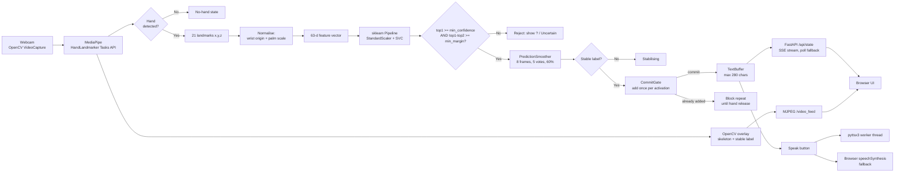
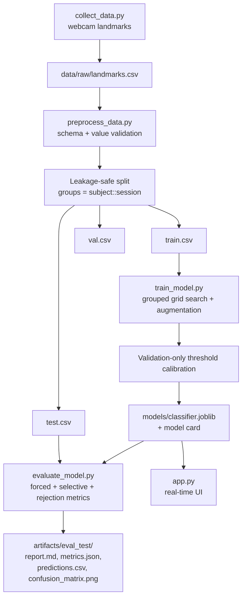

# Sign to Speech — ASL Static Fingerspelling Recognition

A local, real-time web application that recognises **24 static American Sign
Language (ASL) fingerspelling handshapes**, appends them to text, and can speak
the result. It uses a webcam, MediaPipe hand landmarks, a scikit-learn
classifier, FastAPI, and optional local or browser speech.

> **Scope and honesty note**
>
> This is a **static ASL fingerspelling recogniser**, not a sign-language
> translator. It does **not** understand ASL grammar, facial expression,
> continuous signing, or any other sign language. **J and Z are not supported**
> because they require motion.
>
> **No real recognition accuracy has been measured yet.** The only trained model
> in the project is a **synthetic demo model** built from generated landmarks.
> Its metrics are pipeline checks and must never be cited as sign-language
> recognition accuracy. Real accuracy requires collecting real samples from
> multiple people and sessions, then running the held-out evaluation.

---

## Contents

1. [What actually works](#1-what-actually-works)
2. [Scope and non-goals](#2-scope-and-non-goals)
3. [Demo model vs real model](#3-demo-model-vs-real-model)
4. [Architecture](#4-architecture)
5. [Project structure](#5-project-structure)
6. [Requirements and installation](#6-requirements-and-installation)
7. [Quick start: synthetic demo](#7-quick-start-synthetic-demo)
8. [Real workflow: collect, split, train, evaluate, run](#8-real-workflow-collect-split-train-evaluate-run)
9. [Command reference](#9-command-reference)
10. [Data format and storage](#10-data-format-and-storage)
11. [Leakage-safe splitting](#11-leakage-safe-splitting)
12. [Features](#12-features)
13. [Model, rejection, and smoothing](#13-model-rejection-and-smoothing)
14. [Web UI](#14-web-ui)
15. [HTTP API](#15-http-api)
16. [Evaluation outputs](#16-evaluation-outputs)
17. [Synthetic demo results (not recognition accuracy)](#17-synthetic-demo-results-not-recognition-accuracy)
18. [Verification log](#18-verification-log)
19. [Known limitations and not-yet-implemented items](#19-known-limitations-and-not-yet-implemented-items)
20. [Troubleshooting](#20-troubleshooting)
21. [Privacy, consent, and licensing](#21-privacy-consent-and-licensing)
22. [Roadmap](#22-roadmap)
23. [File-by-file summary](#23-file-by-file-summary)
24. [Academic use](#24-academic-use)

---

## 1. What actually works

This table separates what has been run and observed from what is only
implemented code.

| Component | Status | Evidence / notes |
|---|---|---|
| MediaPipe hand landmark detection | **Working** | Verified on a real hand photo (1 hand, `Right`, score 0.985) and live webcam (`Right`, score 1.00). |
| Webcam capture | **Working** | Opened through DirectShow on Windows; 8–10 fps in the test environment (hardware-dependent). |
| FastAPI web UI | **Working** | Page loads with no browser console warnings/errors; `GET /api/health` returned `200`. |
| Trained model loading | **Working** | Synthetic demo bundle and real SVM bundle load: 24 classes, format version 2. The real model is `models/classifier.joblib`. |
| Frame-level prediction + rejection | **Working** | Uncertain real-hand frames were rejected (`?`, "Uncertain") with top-1 confidence around 12%. |
| Temporal smoothing and commit gate | **Working** | Commit after stable votes; repeat blocked while held; re-commit after release or *Add letter*. Covered by automated tests. |
| Text buffer (letters, space, delete, undo, clear, capacity) | **Working** | Exercised in smoke checks, UI/API wiring, and automated tests. |
| Server-side speech (pyttsx3) | **Initialises** | `state=ready`, 2 voices on Windows. Audible output was not verified headlessly. Browser `speechSynthesis` fallback is implemented. |
| Synthetic end-to-end pipeline | **Working** | `scripts/build_demo.py` completed: generate → validate → split → train → evaluate. |
| Real-data pipeline | **Working** | Kaggle import (30,666 usable landmarks), merge, grouped preprocess, SVM/RF training, validation-only selection, and test evaluation completed. `run_real.ps1` wraps the pipeline. |
| Kaggle-derived test accuracy | **Measured, not subject-disjoint** | SVM: forced accuracy 92.06%, macro-F1 88.88%, selective 98.06% at 87.46% coverage. All rows use `subject_id=kaggle`, so this is not unseen-signer accuracy. Live webcam `A` and `G` were recognized and committed once. |
| Automated test suite | **In progress** | API, feature, collector, smoothing, calibration/bundle, and evaluation tests exist; the full regression and coverage gate are still being completed. |
| Academic report/presentation files | **Not included** | `docs/` exists but is largely empty. |

---

## 2. Scope and non-goals

### In scope

- American Sign Language (ASL) **static fingerspelling**.
- 24 letters: `A B C D E F G H I K L M N O P Q R S T U V W X Y`.
- One hand per frame; the most confident detection is used.
- Frame-level classification with confidence/margin rejection.
- Temporal smoothing plus a commit gate so a held sign is added once.
- Committed text editing, speech output, and a local browser UI.
- A leakage-aware data pipeline and an honest evaluation workflow.

### Explicitly out of scope

- **J and Z** (dynamic motion).
- ASL grammar, sentence formation, continuous signing, or translation.
- Facial expression, body pose, or non-manual markers.
- Other sign languages (ISL, BSL, BISINDO, etc.).
- Two-handed signs or multi-signer scenes.
- Word prediction or automatic spacing (spacing is a user action).
- Medical, accessibility-critical, or production deployment claims.

The UI and model metadata carry these limits so results cannot be presented
out of context.

---

## 3. Demo model vs real model

The application selects its model by command line:

| Command | Model file | Meaning |
|---|---|---|
| `python app.py --demo` | `models/demo_classifier.joblib` | **Synthetic** plumbing demo. A warning banner is always shown. |
| `python app.py --model models/classifier.joblib` | your trained model | Real model path. |
| `python app.py` | `models/classifier.joblib` | Default; currently **does not exist** until you train it. The UI shows "No model loaded" and explains how to fix it. |

The demo model is trained on generated hand-like landmarks
(`src/demo_data.py`), not on photographs or real signers. Real hands will often
produce low confidence and be rejected. That is expected: it demonstrates the
rejection path working, not ASL recognition.

The backend exposes `model_is_synthetic` and `model_metadata.training.dataset_kind`.
The front end shows a prominent warning whenever the dataset kind is `synthetic`
or `mixed`.

---

## 4. Architecture

### 4.1 Runtime pipeline (webcam → text → speech)



Frame processing happens in a dedicated camera thread. Results are published
under a lock; FastAPI request threads only read snapshots or enqueue speech
commands.

### 4.2 Training pipeline



### 4.3 Design decisions

- **Grouped splitting, not random splitting:** frames from one recording
  session are highly correlated. Splitting randomly leaks near-duplicates.
- **Orientation preserved:** signed handshapes depend on hand orientation, so
  features are translation- and scale-normalised but not rotated into a
  canonical pose.
- **Handedness excluded from features:** a static letter is not defined by which
  hand is used; including handedness invites signer-specific shortcuts.
- **Rejection before smoothing:** low-confidence frames never enter the voting
  window.
- **One commit per activation:** holding a letter does not spam the text.
- **Test split is read only by `evaluate_model.py`:** training loads only
  `train.csv` and `val.csv`.

---

## 5. Project structure

```text
Sign Language Recognition/
├── app.py                      # FastAPI app factory, SSE, MJPEG stream, CLI
├── collect_data.py             # Webcam landmark collection CLI
├── preprocess_data.py          # Validation + leakage-safe split CLI
├── train_model.py              # Grouped tuning, training, calibration, model card
├── evaluate_model.py           # Held-out evaluation and reports
├── requirements.txt            # Pinned, tested dependency versions
├── README.md                   # This document
├── THIRD_PARTY_NOTICES.md      # Dependency/model licences
├── .gitignore
│
├── src/
│   ├── config.py               # Paths, label set, CSV schema, defaults
│   ├── features.py             # 21x3 landmarks -> 63-d normalised vector
│   ├── augmentation.py         # Training-only landmark augmentation
│   ├── dataset.py              # Validation, grouped splitting, manifests
│   ├── collector.py            # Sample rows and append-only CSV writing
│   ├── demo_data.py            # Synthetic hand landmark generator
│   ├── hand_tracking.py        # MediaPipe Tasks wrapper + OpenCV overlay
│   ├── model_bundle.py         # Pipeline builders, bundle save/load, rejection
│   ├── calibration.py          # Validation-only confidence/margin search
│   ├── smoothing.py            # PredictionSmoother, CommitGate, RecognitionSession
│   ├── runtime.py              # Camera thread, status payload, UI controls
│   ├── text.py                 # TextBuffer with undo and capacity
│   ├── speech.py               # Threaded pyttsx3 service
│   └── evaluation.py           # Metrics, ECE/Brier, confusion matrix plots
│
├── scripts/
│   ├── download_models.py      # Download + SHA-256 verify hand_landmarker.task
│   ├── check_hand_tracking.py  # Phase-1 image/webcam landmark check
│   ├── make_demo_dataset.py    # Generate synthetic landmark CSV
│   ├── build_demo.py           # One-command synthetic end-to-end demo
│   └── import_image_dataset.py # Optional class-folder image -> landmarks helper
│
├── templates/
│   └── index.html              # Single-page UI
├── static/
│   ├── style.css               # Responsive dark UI, accessible focus states
│   └── app.js                  # 250 ms polling, controls, TTS fallback
│
├── models/
│   ├── hand_landmarker.task    # Downloaded MediaPipe asset (verified SHA-256)
│   ├── demo_classifier.joblib  # Generated synthetic demo model
│   └── demo_model_card.json    # Generated demo model card
│
├── data/
│   └── demo/                   # Generated synthetic data + processed splits
│
├── artifacts/
│   └── demo_eval/              # Generated demo evaluation artefacts
│
├── docs/                       # Project documentation (in progress)
└── tests/                      # pytest suite (in progress)
```

Generated files (`data/demo`, `artifacts`, `models/*.joblib`, the downloaded
`.task`) are ignored by `.gitignore`; rebuild them with the commands below.

---

## 6. Requirements and installation

### Tested environment

- **OS:** Windows (webcam backend `dshow`)
- **Python:** 3.13.5
- **Hardware:** webcam, speakers/headphones for speech
- **Network:** needed once to download the MediaPipe hand model

### Install

```powershell
cd "N:\RESUME_PROJECTS\Sign Language Recognition"

python -m venv .venv
.\.venv\Scripts\Activate.ps1

python -m pip install --upgrade pip
python -m pip install -r requirements.txt
```

Pinned versions: MediaPipe 1.1.1, OpenCV contrib 5.0.0.93, scikit-learn 1.6.1,
NumPy 2.1.3, pandas 2.2.3, FastAPI 0.116.1, Uvicorn 0.35.0, pyttsx3 2.98,
joblib 1.4.2, Matplotlib 3.10.0, seaborn 0.13.2.

> **Important:** MediaPipe 1.1.1 no longer provides `mp.solutions`. This project
> uses the Tasks API (`mediapipe.tasks.python.vision.HandLandmarker`). If you
> installed an older package set and see `module 'mediapipe' has no attribute
> 'solutions'`, reinstall from `requirements.txt`.
>
> **OpenCV:** keep `opencv-contrib-python` as the only OpenCV wheel. Mixing it
> with `opencv-python` or `opencv-python-headless` can break `import cv2`.

### Download the hand model

The model is not committed. Download and verify it:

```powershell
.\.venv\Scripts\python.exe scripts\download_models.py
```

Expected result:

```text
Saved and verified: ...\models\hand_landmarker.task
  size: 7819105 bytes
  sha256: fbc2a30080c3c557093b5ddfc334698132eb341044ccee322ccf8bcf3607cde1
```

`--force` re-downloads and re-verifies.

---

## 7. Quick start: synthetic demo

This proves the whole pipeline without a webcam or real dataset.

```powershell
# 1. Build synthetic data, split it, train, and evaluate
.\.venv\Scripts\python.exe scripts\build_demo.py

# 2. Launch the UI with the synthetic model
.\.venv\Scripts\python.exe app.py --demo
```

Open **http://127.0.0.1:8501**. If the port is busy, add `--port 5000`.

What you should see:

- A yellow **"Demo model — synthetic data"** banner that cannot be missed.
- Model badge: **Demo model**; model kind: **synthetic demo**.
- 24 classes; validation macro-F1 around 0.973 **(synthetic only)**.
- Thresholds around `0.50 / 0.00`; smoothing `8 frames · 5 votes`.
- Speech status **"Server voice ready (pyttsx3)"** when audio initialises.
- Click **Start camera**, allow one hand in frame, and watch:
  - landmarks and the hand skeleton overlay;
  - top alternatives and confidence;
  - `?` / "Uncertain" for rejected frames;
  - committed letters in the text box.

Real hands will mostly be rejected by this synthetic model. That is the
correct, honest behaviour; it is not evidence of ASL accuracy.

To stop the server, press `Ctrl+C` in the terminal.

### Demo build artefacts

`scripts/build_demo.py` runs:

1. `scripts/make_demo_dataset.py` → `data/demo/landmarks.csv`
2. `preprocess_data.py --test-subjects demo-s02` → `data/demo/processed/`
3. `train_model.py --model svm` → `models/demo_classifier.joblib`
4. `evaluate_model.py --split test` → `artifacts/demo_eval/`

Useful flags:

```powershell
.\.venv\Scripts\python.exe scripts\build_demo.py --skip-eval
.\.venv\Scripts\python.exe scripts\build_demo.py --no-tune --augment-copies 0
```

---

## 8. Real workflow: collect, split, train, evaluate, run

### Step 1 — Collect real samples

Record each letter in **multiple sessions**, with different hand positions,
angles, lighting, backgrounds, and (ideally) multiple people.

```powershell
# One letter per command. Use a new session id for each sitting.
.\.venv\Scripts\python.exe collect_data.py --label A --subject s01 --session s01a --count 150

# Non-target gestures for rejection calibration (optional but recommended)
.\.venv\Scripts\python.exe collect_data.py --label _unknown --subject s01 --session s01a --count 100
```

Repeat for all 24 letters and, ideally, at least three subjects. A reasonable
starting target is **3+ subjects × 2+ sessions × 100–150 samples per letter**.
The code enforces only structural minimums; it cannot guarantee accuracy from
sample count.

Collection controls: `Q` quits, `SPACE` pauses/resumes. Frames are saved only
when a hand is present, the hand score is at least `--min-hand-score`, and the
hand is not touching the frame edge or too small.

### Step 2 — Create leakage-safe splits

```powershell
# Recommended: hold out entire people for the test split
.\.venv\Scripts\python.exe preprocess_data.py `
  --input data\raw\landmarks.csv `
  --out data\processed `
  --test-subjects s03
```

If you omit `--test-subjects`, the script uses `StratifiedGroupKFold` and the
test split is grouped by session but **not guaranteed to contain unseen people**.

### Step 3 — Train

```powershell
.\.venv\Scripts\python.exe train_model.py `
  --processed data\processed `
  --model svm `
  --out models\classifier.joblib
```

Training reads **only** `train.csv` and `val.csv`. Thresholds are calibrated on
validation data, including `_unknown` samples when present.

### Step 4 — Evaluate once on the held-out test split

```powershell
.\.venv\Scripts\python.exe evaluate_model.py `
  --processed data\processed `
  --model models\classifier.joblib `
  --split test
```

Do not tune on the test split. Outputs go to `artifacts/eval_test/` by default.

### Step 5 — Run the real app

```powershell
.\.venv\Scripts\python.exe app.py --model models\classifier.joblib --autostart
```

The demo banner disappears automatically because `model_is_synthetic` is false
for webcam/imported data.

### Optional: bootstrap from the Kaggle ASL Alphabet images

If you have the Kaggle ASL Alphabet image dataset, import landmarks and merge
them with your own webcam samples:

```powershell
.\.venv\Scripts\python.exe scripts\import_image_dataset.py `
  --root Dataset_kaggle\asl_alphabet_train `
  --max-per-class 1500 `
  --output data\imported\landmarks.csv

.\.venv\Scripts\python.exe scripts\merge_datasets.py `
  --imported data\imported\landmarks.csv `
  --raw data\raw\landmarks.csv `
  --out data\merged\landmarks.csv
```

Then preprocess to `data\processed_kaggle`, train SVM and Random Forest
candidates, and copy the better validation macro-F1 model to
`models\classifier.joblib`. The whole pipeline is available as one command:

```powershell
powershell -ExecutionPolicy Bypass -File .\run_real.ps1
```

The importer writes landmarks only, supports `--resume`, reports per-class
MediaPipe detection rates, keeps the 24 static letters, maps `nothing` to
`_unknown`, and skips `J`, `Z`, `del`, and `space`. Imported images are grouped
into pseudo-sessions, so the resulting test split is **not subject-disjoint**.
The small `asl_alphabet_test` folder is not used; validation and test splits are
built from `asl_alphabet_train`.

### Measured Kaggle run (2026-10-29)

The public Kaggle ASL Alphabet training folder was imported with a fixed seed,
at most 1,500 images per class. MediaPipe found a usable hand in 30,666 of
37,500 sampled images (81.8%); 6,834 were discarded. The lowest rates were
`N` 67.3%, `C` 77.3%, `B` 77.9%, `M` 78.3%, and `X` 78.7%; `nothing` produced
only 39 usable `_unknown` samples. The 24 static letters plus `_unknown` were
split into 18,439 train / 6,276 validation / 5,951 test rows over 367
pseudo-sessions. No session crosses splits, but every row has
`subject_id=kaggle`, so the test split is **not subject-disjoint**.

| Candidate | Val accuracy | Val macro-F1 | Val selective accuracy | Val coverage |
|---|---:|---:|---:|---:|
| SVM (selected) | 90.76% | 89.84% | 97.53% | 87.11% |
| Random Forest | 89.47% | 87.94% | 93.90% | 92.81% |

Test results for the selected SVM (`artifacts/eval_test_real/`):

- Forced accuracy: **92.06%** (grouped bootstrap 95% CI 89.03–94.56%).
- Forced macro-F1: **88.88%** (the grouped-session bootstrap interval is wide
  and unstable because rare test classes occupy few sessions).
- Selective accuracy: **98.06%** at **87.46%** coverage.
- Unknown acceptance: 0/4 `_unknown` test samples. Too few to measure rejection
  reliably; validation contained only one `_unknown` sample.
- Top confusions: R→U 33, M→N 32, P→Q 29, M→A 23, R→W 16.

Live check with the real bundle at `http://127.0.0.1:5055`:
`model_loaded=true`, `model_is_synthetic=false`, demo banner hidden, `A` and `G`
each committed once, repeat blocked while held, and
`POST /api/speech/speak` returned `{"ok":true,"message":"Speaking."}`. Audible
output was not independently verified. The test metrics are from detectable
Kaggle images only; they are not a webcam accuracy guarantee.

---

## 9. Command reference

### `collect_data.py`

| Flag | Default | Meaning |
|---|---|---|
| `--label` | required | Static letter or `_unknown` |
| `--subject` | required | Anonymous signer id, e.g. `s01` |
| `--session` | timestamp | Session id; new session per sitting |
| `--count` | `150` | Samples to save |
| `--camera` | `0` | OpenCV camera index |
| `--width`, `--height` | `1280`, `720` | Requested capture size |
| `--interval` | `0.06` | Seconds between saved frames |
| `--countdown` | `3.0` | Countdown before capture |
| `--min-hand-score` | `0.55` | Minimum hand presence score |
| `--no-mirror` | off | Disable horizontal flip |
| `--output` | `data/raw/landmarks.csv` | Append-only CSV destination |

### `preprocess_data.py`

| Flag | Default | Meaning |
|---|---|---|
| `--input` | `data/raw/landmarks.csv` | Raw CSV |
| `--out` | `data/processed` | Split output directory |
| `--seed` | `42` | Deterministic fold seed |
| `--test-subjects` | none | Hold out entire subjects for test |

### `train_model.py`

| Flag | Default | Meaning |
|---|---|---|
| `--processed` | `data/processed` | Processed split directory |
| `--model` | `svm` | `svm` or `rf` |
| `--out` | `models/classifier.joblib` | Model bundle destination |
| `--card` | `<model>_card.json` | Model card destination |
| `--seed` | `42` | Random seed |
| `--cv` | `3` | Grouped CV folds (capped by groups/classes) |
| `--no-tune` | off | Skip grid search |
| `--augment-copies` | `1` | Extra augmented copies per training sample |
| `--target-selective-accuracy` | `0.90` | Calibration constraint |
| `--max-unknown-accept-rate` | `0.20` | Calibration constraint |
| `--min-coverage` | `0.30` | Calibration constraint |

### `evaluate_model.py`

| Flag | Default | Meaning |
|---|---|---|
| `--processed` | `data/processed` | Processed split directory |
| `--model` | required | Model bundle |
| `--split` | `test` | `val` or `test` |
| `--output` | `artifacts/eval_<split>` | Output directory |

### `app.py`

| Flag | Default | Meaning |
|---|---|---|
| `--model` | `models/classifier.joblib` | Model bundle |
| `--demo` | off | Use the synthetic demo model |
| `--camera` | `0` | Camera index |
| `--width`, `--height` | `1280`, `720` | Capture size |
| `--no-mirror` | off | Disable mirroring |
| `--no-speech` | off | Disable server-side pyttsx3 |
| `--autostart` | off | Start the camera on launch |
| `--no-camera` | off | Never auto-open the camera |
| `--host` | `127.0.0.1` | Bind address |
| `--port` | `8501` | Port |
| `--debug` | off | Enable debug logging |

### Helper scripts

| Script | Purpose |
|---|---|
| `scripts/download_models.py [--force]` | Download and SHA-256-verify the MediaPipe hand model |
| `scripts/check_hand_tracking.py --image PATH` | Detect and draw landmarks on one image |
| `scripts/check_hand_tracking.py --camera 0` | Live landmark check window |
| `scripts/make_demo_dataset.py` | Generate synthetic landmarks |
| `scripts/build_demo.py` | Full synthetic demo build |
| `scripts/import_image_dataset.py` | Convert class-folder images to landmark rows |

The image importer is optional and has an important limitation: public image
folders usually lack signer/session metadata. It groups consecutive filenames
into pseudo-sessions, which reduces near-duplicate leakage but **cannot** prove
unseen-signer generalisation. Verify the dataset licence before use.

---

## 10. Data format and storage

Each sample is one row in a CSV with **71 columns**:

- **8 metadata columns:**
  `sample_id, label, subject_id, session_id, source, handedness, hand_score, timestamp`
- **63 coordinate columns:**
  `x0,y0,z0, x1,y1,z1, … x20,y20,z20` (MediaPipe's 21 landmarks)

| Field | Values |
|---|---|
| `label` | One of the 24 static letters, or `_unknown` |
| `source` | `webcam`, `synthetic`, `imported` |
| `handedness` | `Left`, `Right`, `Unknown` |
| `hand_score` | 0–1 hand presence score |
| `sample_id` | Unique id; duplicates are rejected |
| `timestamp` | UTC ISO-8601 |

Dataset kind is derived from `source`:

- all `synthetic` → `synthetic`
- mixture containing `synthetic` → `mixed`
- otherwise → `real`

**Only landmarks are stored, never video frames.**

Default locations:

```text
data/raw/landmarks.csv          # live-collected samples
data/processed/                 # train.csv, val.csv, test.csv, manifest.json
data/demo/                      # synthetic demo data
data/imported/                  # optional image-import output
```

`preprocess_data.py` validates the schema, label set, duplicate ids, score
ranges, and finite coordinates. Warnings cover low hand scores, tiny classes,
strong imbalance, single-session labels, and missing `_unknown` samples.

---

## 11. Leakage-safe splitting

- A **group** is `subject_id::session_id`.
- No group may appear in more than one split. The code asserts this and also
  asserts that no `sample_id` is shared.
- With `--test-subjects`, every session of those people goes to test; the
  remaining groups are split into train/validation with
  `StratifiedGroupKFold`.
- Without `--test-subjects`, fold 0 becomes test, fold 1 validation, and the
  rest training. This is **session-disjoint**, not necessarily
  **person-disjoint**.
- The training split must contain all 24 letters, otherwise the run fails.
- Validation/test splits may be missing a letter; per-class metrics for that
  letter are then not estimable and a warning is emitted.
- A manifest records the source SHA-256, row counts, groups, subjects, class
  counts, split method, seed, warnings, and whether test is subject-disjoint.
- `train_model.py` loads only `train` and `val`; the test CSV is not even parsed.

The demo uses `--test-subjects demo-s02`, so its test split is subject-disjoint.

---

## 12. Features

For each detected hand:

1. Translate all 21 landmarks so the **wrist** is at the origin.
2. Compute the mean distance from the wrist to the palm-base joints
   (landmarks **5, 9, 13, 17**).
3. Divide all coordinates by that scale.
4. Flatten to **63 numbers**.

This removes position and distance from the camera while **preserving hand
orientation**, which matters in signed languages. Handedness is stored as
metadata but is **not** a model feature. Degenerate geometry (zero palm scale),
wrong shapes, and non-finite values raise `FeatureError`.

Training-only augmentation (`src/augmentation.py`): mirror with probability 0.5,
rotation ±12°, scale jitter ±6%, translation jitter ±0.015, landmark noise 0.006,
depth noise 0.004. Augmented rows are re-normalised and never used for
validation, test, calibration, or evaluation.

---

## 13. Model, rejection, and smoothing

### Classifier

Default: `StandardScaler` + `SVC`

```text
kernel=rbf, C=1.0, gamma=scale, probability=True,
class_weight=balanced, cache_size=1024, random_state=42
```

Alternative: `RandomForestClassifier` with 400 trees, balanced subsampling.

Grouped grid search (never random):

| Model | Grid |
|---|---|
| SVM | `C ∈ {1, 10}`, `gamma ∈ {scale, 0.01}` |
| RF | `max_depth ∈ {None, 24}`, `min_samples_leaf ∈ {1, 2}` |

Scoring is macro-F1 with `StratifiedGroupKFold`; if there are too few groups or
classes, tuning is skipped and defaults are used.

### Rejection rule

A frame is accepted only if:

```text
top1_probability >= min_confidence
AND (top1_probability - top2_probability) >= min_margin
```

Thresholds are searched on **validation data only** over
confidence `0.30–0.95` (14 steps) and margin `0.00–0.50` (11 steps). The search
maximises coverage subject to selective-accuracy, minimum-coverage, and
unknown-accept constraints. Status values:

- `calibrated_on_validation`
- `constraints_not_met`
- `default_heuristic` / `calibration_failed_no_acceptances`

If validation contains `_unknown` samples, they constrain false accepts.
Otherwise unknown-sign rejection is explicitly reported as unmeasured.

### Smoothing and commit gate

- **Window:** 8 accepted frames
- **Minimum votes:** 5
- **Minimum ratio:** 60% of the filled window
- **Release frames:** 8 frames without a hand re-arm the gate

A stable letter is committed once. While it remains held, repeats are blocked.
Lower the hand for ~8 frames, or press **Add letter**, to repeat the letter.
Changing to a different stable letter commits it after smoothing.

### Text buffer

- Supports the 24 static letters and spaces.
- Maximum 280 characters.
- Undo history up to 100 states.
- No automatic spacing or word prediction.

### Model bundle

A `.joblib` file contains a versioned dictionary:

```text
format_version, created_utc, feature_dim, labels,
thresholds, metadata, estimator
```

Loading validates the format version, required keys, label order against the
fitted estimator, feature dimension, and `predict_proba` support. Saves are
atomic (temporary file + `os.replace`).

> **Security:** joblib/pickle files can execute code. Load only model files
> produced by this project or another trusted source.

---

## 14. Web UI

The single page at `/` is intentionally simple:

1. **Header** — app name, one-line purpose, and Theme, Shortcuts, and About
   buttons.
2. **Camera** — live preview, one camera status line, Start/Stop, camera picker,
   and a collapsed one-photo fallback for machines without a webcam.
3. **Detected letter** — one very large letter, confidence bar, hold-progress
   ring, and a single plain-language status line.
4. **Your text** — read-only text area, character count, Speak, Space, Delete,
   and Clear. Undo, Copy, Save, and Add letter live under **More**.
5. **Help** — tips for best results, a collapsed ASL alphabet reference, and a
   footer that states the static-only scope.

A three-step onboarding card appears once on first use and is remembered in
`localStorage`. Voice settings are collapsed behind the gear button; the visible
voice state is only “Voice ready” or “Voice unavailable”.

The demo banner appears only for synthetic models and links to About. About
states the scope plainly: static ASL fingerspelling, 24 letters, no J or Z, and
not a sign-language translator.

Developer details are hidden from normal users. Add `?dev=1` to the URL to show
the model kind, fps, hand score, thresholds, validation macro-F1, smoothing
values, top alternatives, and Reload model inside the About dialog.

Behaviour:

- Streams state over SSE (`/api/events`) and falls back to `/api/state` polling.
- Disables unavailable actions and explains why in the tooltip.
- Falls back to the browser's `speechSynthesis` if server speech is unavailable.
- Uses plain-language errors, one suggested fix, and a reconnect banner.
- Includes a skip link, labelled controls, `aria-live` regions, visible focus
  styles, reduced-motion handling, and tested light and dark themes.

---

## 15. HTTP API

All endpoints are local to the FastAPI server. JSON responses include `ok`.

| Method | Path | Body | Purpose |
|---|---|---|---|
| `GET` | `/` | — | Web UI |
| `GET` | `/docs` | — | Interactive OpenAPI documentation |
| `GET` | `/api/health` | — | Health check |
| `GET` | `/api/version` | — | Version and build information |
| `GET` | `/api/state` | — | Full runtime snapshot |
| `GET` | `/api/events` | — | Server-Sent Events state stream |
| `GET` | `/api/cameras` | — | Available camera devices |
| `GET` | `/video_feed` | — | MJPEG preview (placeholder when camera off) |
| `POST` | `/api/camera/start` | `{"index": 0}` | Start camera |
| `POST` | `/api/camera/stop` | — | Stop camera |
| `POST` | `/api/model/reload` | — | Reload the configured model |
| `POST` | `/api/text/add` | — | Commit the current stable sign |
| `POST` | `/api/text/space` | — | Append a space |
| `POST` | `/api/text/delete` | — | Delete one character |
| `POST` | `/api/text/undo` | — | Undo the last text change |
| `POST` | `/api/text/clear` | — | Clear all text |
| `POST` | `/api/text/suggest` | `{"text": "..."}` | Optional text-only LLM suggestion |
| `POST` | `/api/speech/speak` | `{"text": "..."}` | Speak text (or current text) |
| `POST` | `/api/speech/stop` | — | Stop speech |
| `POST` | `/api/speech/settings` | `{"voice", "rate", "volume"}` | Update speech settings |
| `POST` | `/api/predict/image` | multipart `file` | Predict from one image, no webcam |

The state payload includes: camera status/fps/error, hand presence/handedness/
score, raw and stable predictions, top alternatives, committed text, undo
availability, speech state, thresholds, smoothing settings, scope description,
notices, and `limits.max_text_length`.

Example checks:

```powershell
Invoke-RestMethod http://127.0.0.1:8501/api/health
Invoke-RestMethod http://127.0.0.1:8501/api/state |
  Select-Object model_loaded, model_is_synthetic, camera_running, hand_present, stable_label
```

---

## 16. Evaluation outputs

`evaluate_model.py --split test` writes to `artifacts/eval_test/`:

| File | Contents |
|---|---|
| `report.md` | Human-readable summary with per-class table and confusions |
| `metrics.json` | Machine-readable metrics and provenance |
| `classification_report.txt` | sklearn report + rejection summary |
| `predictions.csv` | Per-sample label, prediction, confidence, margin, acceptance |
| `confusion_matrix.png` | Forced-prediction confusion matrix |

Metrics include:

- Forced accuracy, macro/weighted precision, recall, F1, per-class metrics.
- Confusion matrix and most frequent confusions.
- Majority-class baseline.
- Selective accuracy and coverage under the saved thresholds.
- Unknown-sign acceptance rate (when `_unknown` samples exist).
- Expected calibration error (ECE) and Brier score.
- Subject-disjointness of the evaluated split.

**Forced accuracy ignores rejection** and is not the deployed system's accuracy.
**Selective accuracy** is conditional on acceptance and must be reported with
coverage. **ECE/Brier** describe probability calibration, not accuracy.

---

## 17. Synthetic demo results (not recognition accuracy)

> **WARNING — READ THIS BEFORE QUOTING ANY NUMBER**
>
> The figures below come from **generated landmarks**, not real ASL samples.
> They verify that the data → split → train → evaluate pipeline runs and that
> the reporting code works. They are **not** sign-language recognition accuracy
> and must not be presented as such in a report, résumé, or demo.

Demo dataset:

- 2,964 synthetic samples: 24 letters + `_unknown`
- 3 synthetic subjects, 6 sessions
- Test subject `demo-s02` held out (2 sessions, 988 samples: 960 known + 28 unknown)

Measured on the synthetic test split (from `artifacts/demo_eval/`):

| Metric | Value |
|---|---:|
| Forced accuracy (known classes) | 0.9802 |
| Forced macro-F1 | 0.9803 |
| Majority-class baseline | 0.0417 |
| Selective accuracy | 0.9894 |
| Coverage | 0.9802 |
| Unknown acceptance rate | 0.2143 |
| ECE | 0.0756 |
| Brier score | 0.0439 |

Validation-only calibration produced thresholds `min_confidence = 0.50`,
`min_margin = 0.00` (coverage 0.9896, selective accuracy 0.9768, unknown accept
0.1429). Validation macro-F1 was about 0.9726.

Why these numbers are meaningless as recognition results:

- The classes are generated from distinct synthetic finger configurations; they
  are far more separable than real hands.
- Validation contained only one session group, so calibration is fragile.
- Unknown acceptance rose from 14.3% on validation to 21.4% on test, already
  showing a generalisation gap.
- In the live check, a real hand produced top-1 ≈ 12% and was rejected, which is
  the correct behaviour for a synthetic model.

The UI banner and model card repeat this warning.

---

## 18. Verification log

Verified during development in October 2026 on Windows with Python 3.13.5.
These are observations; the measured Kaggle evaluation is in section 8.

| Check | Command / action | Observed result |
|---|---|---|
| Hand model download | `python scripts/download_models.py` | 7,819,105 bytes; SHA-256 matched `fbc2a300…07cde1` |
| Hand detection, image | `python scripts/check_hand_tracking.py --image ...` | 1 hand, `Right`, score 0.985 |
| Demo build | `python scripts/build_demo.py` | Generated 2,964 rows, splits, model, and `artifacts/demo_eval/` |
| Demo model metadata | `GET /api/state` | 24 classes; `dataset_kind=synthetic`; validation macro-F1 0.9726 |
| Web UI load | Open `http://127.0.0.1:5000` | Title and all regions rendered; no console warnings/errors |
| Health endpoint | `GET /api/health` | `200 {"ok":true,...}` |
| Camera start | `POST /api/camera/start {"index":0}` | `running=true`, backend `dshow`, 8–10 fps |
| Hand tracking, live | `GET /api/state` | `hand_present=true`, `Right`, score 1.00 |
| Rejection, live | `GET /api/state` | Top-1 ≈ 12%; `raw_accepted=false`; display `?`; status "Uncertain" |
| Speech service | `GET /api/state` | `state=ready`, backend `pyttsx3`, 2 voices |
| UI model facts | DOM check | `24` classes; `0.973 (val)`; `8 frames · 5 votes`; thresholds `0.50 / 0.00` |
| Text capacity | `GET /api/state` | `limits.max_text_length = 280`; UI shows `0 / 280` |
| Kaggle import | `scripts/import_image_dataset.py` | 30,666 / 37,500 usable; 25 classes; per-class rates in `artifacts/import_detection_rates.txt` |
| Real model loaded | `GET /api/state` | `model_loaded=true`; `model_is_synthetic=false`; demo banner hidden |
| Real test metrics | `evaluate_model.py --split test` | Forced accuracy 92.06%; macro-F1 88.88%; selective 98.06% at 87.46% coverage |
| Live real signs | Hold `A`, then `G` | Each committed once; repeat blocked while held; text became `AG` |
| Speech endpoint | `POST /api/speech/speak` | `{"ok":true,"message":"Speaking."}` |

Not verified:

- Unseen-signer accuracy (the Kaggle-derived test split is pseudo-session grouped, not subject-disjoint).
- Audible speech output (engine initialised; no speaker verification headlessly).
- Behaviour on macOS/Linux.
- Full automated test suite (3 pre-existing `tests/test_evaluation.py` failures remain).

---

## 19. Known limitations and not-yet-implemented items

### Scientific / linguistic

- Static single-frame classifier only; **J and Z are impossible** by design.
- No grammar, sentence context, facial expression, or continuous signing.
- No other sign languages.
- One hand only; a second hand is ignored (the most confident detection wins).
- No signer adaptation; a model trained on one population may not generalise.
- No measurement of real-world accuracy yet.

### Engineering

- No automated tests, CI, linting configuration, or type-checking run.
- No packaging (`pyproject.toml`), Dockerfile, or dependency lock beyond pins.
- Uvicorn development server, localhost only, no authentication or TLS.
- No rate limiting; the API is designed for a single local user.
- No camera-device enumeration; the index is numeric.
- No session recording or server-side text history. Theme and onboarding are remembered in the browser.
- No model versioning/migration beyond format version rejection.
- No Mac/Linux validation.
- `docs/` is still being filled in; the test suite is not yet complete.
- The demo model in `models/` is generated and ignored by git.

### Evaluation

- Test split is only as good as the collected metadata. If `subject_id` is
  reused across people (or omitted), unseen-person claims are invalid.
- The image importer's pseudo-sessions cannot establish signer disjointness.
- Calibration uses a single validation split.
- No confidence-interval or significance testing.
- No fairness analysis across skin tone, hand size, lighting, or camera quality.

---

## 20. Troubleshooting

| Symptom | Likely cause | Fix |
|---|---|---|
| `Model file not found: ...classifier.joblib` | No real model trained | Run the demo (`--demo`) or train a model |
| `module 'mediapipe' has no attribute 'solutions'` | Old MediaPipe code/version | Use this project's Tasks-API code and pinned MediaPipe 1.1.1 |
| `Hand landmark model not found` | Asset missing | `python scripts/download_models.py` |
| Camera will not open | Another app owns it, wrong index, permissions | Close other camera apps, try `--camera 1`, check Windows privacy settings |
| Camera opens but 0 fps | Device/driver delay or backend issue | Wait a few seconds; the app retries DirectShow then the default backend |
| `import cv2` fails | Missing or conflicting OpenCV wheels | `pip uninstall opencv-python opencv-python-headless`, reinstall `opencv-contrib-python==5.0.0.93` |
| Port already in use | Another server on 8501 | `python app.py --port 5000` |
| Speech stays `unavailable` | No audio device, SAPI issue, or COM problem | Check audio; use the browser voice fallback or `--no-speech` |
| Browser voice does not start | Autoplay/permission policy | Click **Speak** again; check browser audio permissions |
| Model fails to load after upgrade | scikit-learn/joblib version mismatch | Retrain the model with the current environment |
| Demo predictions are always `?` | Synthetic model does not fit real hands | Expected; collect real data and retrain |
| `No '_unknown' samples` warning | Rejection data absent | Record `_unknown` sessions |
| Split fails: "Need at least 3 groups" | Too few sessions/subjects | Collect more sessions or subjects |
| Split fails: "Training split must contain every static ASL letter" | Missing letter in training groups | Collect the missing letters in additional sessions |

---

## 21. Privacy, consent, and licensing

- **Local processing:** video frames are processed on the same machine that runs
  the server. They are not uploaded. The browser receives a local MJPEG stream
  from `127.0.0.1`.
- **Landmarks only:** the collection script stores 21 landmark coordinates plus
  metadata, not images or video.
- **Consent:** obtain explicit permission before recording another person.
  Explain what is stored and how it will be used. Use anonymous subject ids.
- **Data minimisation:** collect only what you need; delete raw data when it is
  no longer required.
- **Model files are code:** only load trusted `.joblib` bundles.
- **No bundled third-party training images:** the working tree contains generated
  synthetic rows and the downloaded MediaPipe model asset, but no third-party
  sign-language photographs.
- **Licences:** see `THIRD_PARTY_NOTICES.md`. MediaPipe and the hand model are
  Apache-2.0; most libraries are BSD/MIT/MPL. Verify licences before
  redistribution.

This prototype is **not** a medical device, accessibility guarantee, or
production identity system.

---

## 22. Roadmap

Short-term, in priority order:

1. Add automated tests for features, splitting/leakage, calibration, smoothing,
   text buffer, model round-trip, and the FastAPI routes with a fake runtime.
2. Collect a real multi-subject, multi-session dataset and publish honest,
   subject-disjoint metrics (forced, selective, coverage, unknown acceptance,
   per-class, ECE).
3. Improve the UI: copy button, keyboard shortcuts, camera dropdown, reconnect
   button, release countdown, and text export.
4. Add a sequence model (e.g. temporal CNN/Transformer) for J, Z, and dynamic
   signs, with a separate evaluation protocol.
5. Add confidence intervals and per-subject/per-condition breakdowns.
6. Add packaging (`pyproject.toml`), CI, linting, and a production WSGI setup if
   the project ever moves beyond local use.

---

## 23. File-by-file summary

| File | Responsibility |
|---|---|
| `src/config.py` | Single source of truth for paths, labels, schema, defaults |
| `src/features.py` | Landmark validation and 63-d normalisation |
| `src/augmentation.py` | Conservative training-only landmark augmentation |
| `src/dataset.py` | Validation report, grouped splitting, manifests, leakage assertions |
| `src/collector.py` | Validated sample rows and append-only CSV writing |
| `src/demo_data.py` | Synthetic hand generator for pipeline tests |
| `src/hand_tracking.py` | MediaPipe Tasks wrapper, detections, OpenCV overlay |
| `src/model_bundle.py` | SVM/RF pipelines, bundle persistence, rejection prediction |
| `src/calibration.py` | Validation-only threshold search and split checking |
| `src/smoothing.py` | Majority smoother, commit gate, session messages |
| `src/runtime.py` | Camera thread, status snapshot, controls, notices |
| `src/text.py` | Committed text with undo and capacity |
| `src/speech.py` | Threaded pyttsx3 worker with graceful failure |
| `src/evaluation.py` | Metrics, ECE/Brier, confusion matrix, JSON writing |
| `app.py` | FastAPI app factory, routes, SSE, MJPEG, startup |
| `templates/index.html` | UI structure and scope/help copy |
| `static/style.css` | Responsive accessible styling |
| `static/app.js` | Polling, rendering, controls, browser TTS fallback |
| `scripts/*` | Model download, hand check, demo generation, image import |

---

## 24. Academic use

If you use this project in a report or presentation:

- Describe it as **"static ASL fingerspelling recognition"**, not translation.
- State that **J and Z are excluded** and explain why.
- Report **forced accuracy, selective accuracy, coverage, and unknown
  acceptance together**; never selective accuracy alone.
- State the split protocol and whether the test set is **subject-disjoint**.
- Do **not** cite the synthetic demo metrics as recognition results.
- Report the number of subjects, sessions, samples per class, and the collection
  conditions.
- Include per-class metrics and the confusion matrix, not just one aggregate.
- Discuss consent, privacy, and the limits of a static classifier.

No academic report, diagrams, or presentation file is included yet. The
`docs/` directory is reserved for those deliverables.

---

## Summary

**Built and runnable:** a local FastAPI app with webcam capture, MediaPipe hand
landmarks, a scikit-learn classifier bundle, confidence/margin rejection,
temporal smoothing, a repeat-safe commit gate, editable text, and pyttsx3 speech
with a browser fallback.

**Also built and runnable:** a leakage-aware data pipeline, grouped training
with validation-only calibration, and a held-out evaluation that produces
per-class metrics, rejection statistics, calibration diagnostics, and a
confusion matrix.

**Not yet done:** real data collection, real accuracy measurement, automated
tests, and the academic write-up. Until those exist, treat this as a working
prototype with a synthetic demo, not a validated ASL recognition system.
